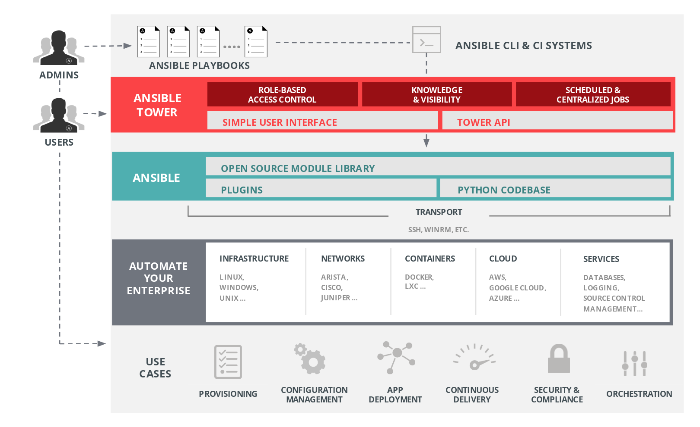
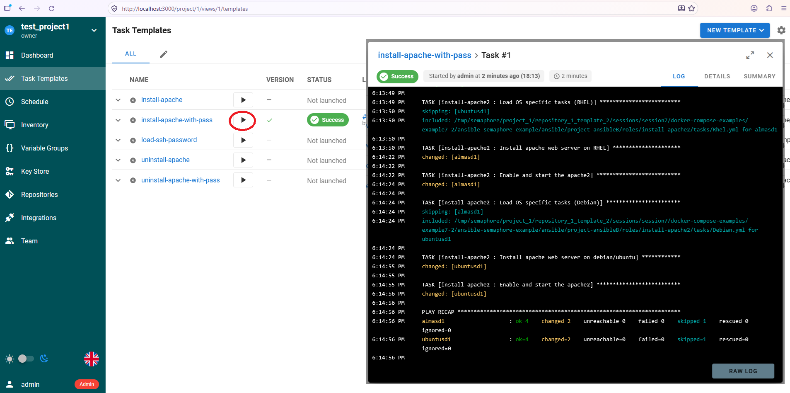
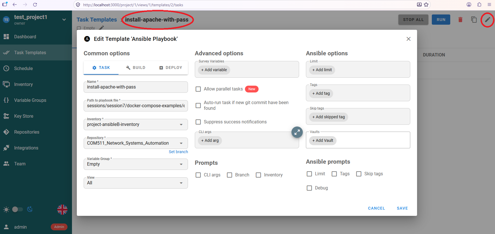
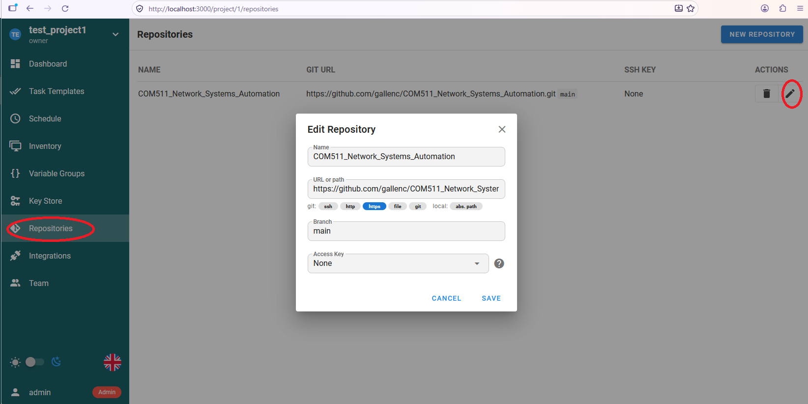
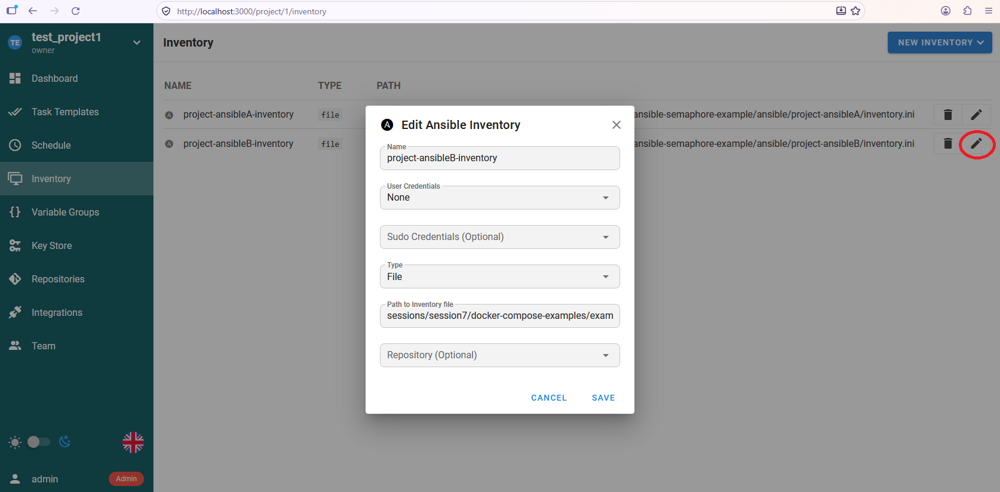
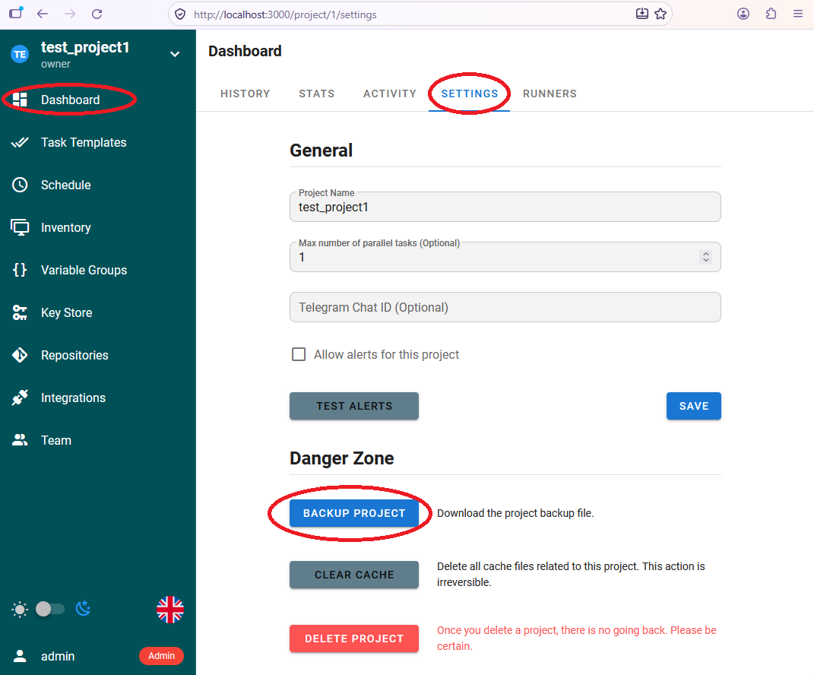
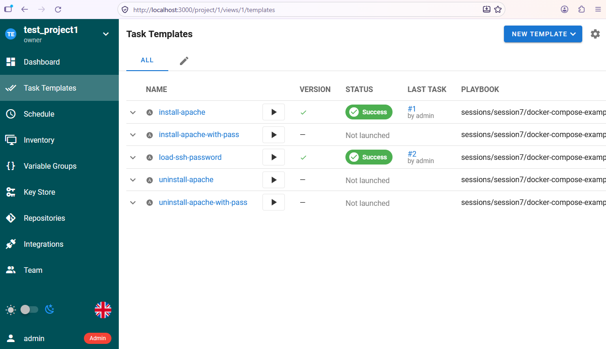

## Ansible Automation

## Introduction

The [Red Hat Ansible Automation Platform](https://docs.ansible.com/projects/ansible/latest/reference_appendices/tower.html) (formerly called Ansible Tower) is the commercial enterprise version of Ansible, developed and supported by Red Hat. It provides a web-based user interface, dashboard, and REST API to help teams scale and control their IT automation. 
It provides the following key features:

* Web UI & Dashboard: Replaces the command-line interface with a visual console for real-time node monitoring and job tracking.
* Role-Based Access Control (RBAC): Manages user and team permissions, with integration for LDAP and Active Directory.
* Job Scheduling: Automates and repeats playbook runs or inventory syncs.
* Workflows: Chains multiple playbooks together into complex, multi-step automated processes.
* Centralised Credentials: Securely stores and manages access keys, SSH credentials, and cloud tokens without exposing them to users.

The Ansible Automation Platform is widely deployed but is complex to set up and use. 

We will be looking at a simpler open source platform, [SemaphoreUI](https://semaphoreui.com/) which provides the same key features but is easier to deploy.

## Semaphore UI

[SemaphoreUI](https://semaphoreui.com/) is an open-source, self-hosted web interface and API control center designed to manage and run DevOps automation tools. 

You can find out more about usage options from the [Semaphore UI Documentation](https://docs.semaphoreui.com/administration-guide/)

Semaphore provides the user with a dashboard with predefined buttons to run scripts on remote machines. 
These scripts can be written in several widely used scripting technologies including Ansible, bash or Kubernetes.
Automations can be run manually or on a schedule or even through a ReST API.

This diagram shows the result of one of our example Ansible scripts being run manually.

SemaphoreUI starts by checking out a clone of a remote repository (or pulling an update if it already exists). 
It then runs a playbook within the repository and records a log of the results.
Thus we have a record of which user logged in to Semaphore has run playbooks and a record of the results of every run.

This image shows a playbook definition.
 

The location of the playbook to be run is entered relative to the root of the chosen repository. 
The inventory to be used with the playbook is chosen from a list of pre-defined inventories.
Additional variables can be defined, and also questions defined to ask users for variables such as passwords.

We can pre-define multiple repositories and multiple inventories.

Each predefined repository is defined with a link to a git hosting site (i.e. github, gitlab or sourceforge), potentially with access keys if the repo is private.

Similarly, each inventory is also located relative to the root of a chosen repository

The SemaphoreUI can support multiple projects. 
Each project can be saved or loaded from a json file, as shown here. 

We can also use the command line to load a project into the UI - which is how we load the default project [test_project_1.json](./ansbible-semaphore-example/container-fs/semaphore/import-project/test_project_1.json) from within the docker compose project.
 
## Ansible projects in the example

In our example, we have defined two ansible projects, both of which are referenced in the semaphore UI.

[project-ansibleB](./ansible-semaphore-example/ansible/project-ansibleB) is a project which uses ssh passwords defined in the inventory to access each of the target containers. 

Look at the [project-ansibleB](./ansible-semaphore-example/ansible/project-ansibleB) first as this is much simpler to understand. 

* [install_apache_with_pass.yml](./ansible-semaphore-example/ansible/project-ansibleB/install_apache_with_pass.yml) installs apache in both of the containers using the ssh password in the inventory.
* [uninstall_apache_with_pass.yml](./ansible-semaphore-example/ansible/project-ansibleB/uninstall_apache_with_pass.yml) uninstalls apache in both of the containers using the ssh password in the inventory.

[project-ansibleA](./ansible-semaphore-example/ansible/project-ansibleA) is a project which uses ssh keys to access each of the target containers.

The basic operation of this project is the same as above except that a `pre-task` is used to unlock the ansible private key using a `passphrase` injected from a docker-compose secret.

* [load-ssh-withpass.yml](./ansible-semaphore-example/ansible/project-ansibleA/load-ssh-withpass.yml) just illustrates how a key is loaded in a `pre-task` and unloaded in a `post-task`.
* [install_apache.yml](./ansible-semaphore-example/ansible/project-ansibleA/install_apache.ym) installs apache in both of the containers using the ssh key with a passphrase.
* [uninstall_apache.yml](./ansible-semaphore-example/ansible/project-ansibleA/uninstall_apache.yml) uninstalls apache in both of the containers using the ssh key with a passphrase.

 Ports 8085 and 8084 are mapped to port 80 in docker compose so once the ansible install-apache scripts have completed, you will be able to see the Apache splash pages on
 * [http://localhost:8085/](http://localhost:8085/) (Ubuntu)
 * [http://localhost:8084/](http://localhost:8084/) (Alma Linux)

