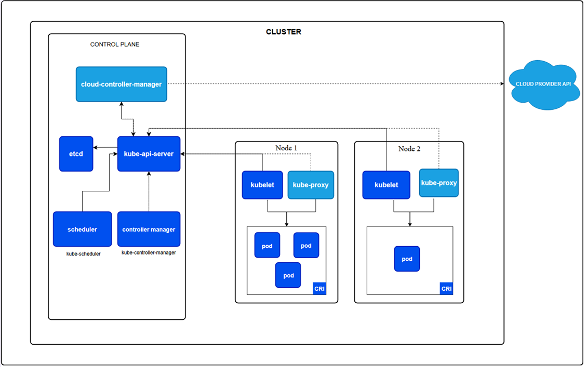
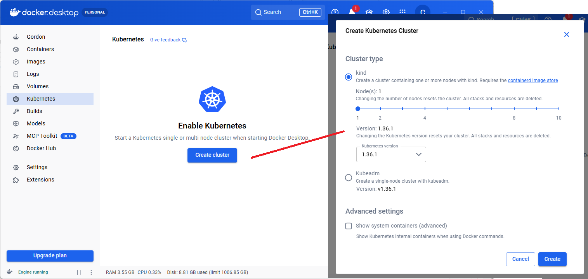
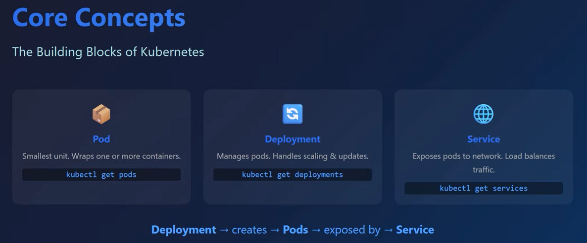

[Main Menu](../../../sessions/README.md) |[session8](../../session8/) | [Session 8 Notes](../docs/sessionNotes.md)

# Session 8 Notes Kuberentes

## Introduction

We have seen how containers provide an isolated abstraction of an operating system environment for running single software components. 

Docker compose provides a simple orchestration framework for running an application based upon multiple containers. 

In many situations docker compose is sophisticated enough to define an application as it can be run stand alone on a virtual machine hosting docker and  many of the cloud service providers provide a means to run docker compose scripts on a serverless container platform.

However for larger deployments, we need greater sophistication in how we manager our containers and this has led to to development of Kubernetes by Google.

[Kubernetes (K8s)](https://kubernetes.io/docs/concepts/overview/) is an open-source container orchestration platform that automates the deployment, scaling, and management of containerised applications. Originally created by Google based on its internal Borg system, it is now maintained by the Cloud Native Computing Foundation (CNCF).

(Acknowledgement: Much of this material is taken from [kubernetes](https://kubernetes.io/docs/concepts) and the [thetips4you Intro to kubernetes ](https://www.youtube.com/watch?v=IluVqhoCChw) )

## Core Architecture

In production deployments, kuberentes is usually deployed across multiple virtual machines with one or more controller nodes and a cluster of worker nodes



* Control Plane: Manages the overall cluster state, scheduling decisions, and API requests. It includes components like the API Server, etcd (key-value store), Scheduler, and Controller Managers.
* Worker Nodes: Physical or virtual machines that run your actual application containers. Each node runs a kubelet (node agent), a container runtime (such as containerd or CRI-O), and kube-proxy for networking.

DockerDesktop provides a simplified environment where the workers and controller are run on a single virtual machine. 
Two kubernetes options are possible in docker desktop

* [kubeadm](https://kubernetes.io/docs/reference/setup-tools/kubeadm/) is the original way DockerDesktop provided kubernetes. It offeres one worker node
* [kind (kubernetes in docker)](https://kind.sigs.k8s.io/) is a tool for running local Kubernetes clusters using Docker container “nodes”. 

Either deployment will do but kubeadm is probably less resource consuming.

To start up a kubernetes cluster in docker desktop, select the settings>kubernetes page and start a cluster. 
Note that this can take some time to come up.



Note that if you select `show kubernetes containers`, `docker ps` will show the running internal kind kubernetes containers as well as your own project

```
docker ps
b60559b3883d   docker/desktop-cloud-provider-kind:v0.8.0          "/bin/cloud-provider…"   2 minutes ago   Up 2 minutes             2375-2376/tcp               kind-cloud-provider
96c61e90ff82   docker/desktop-containerd-registry-mirror:v0.0.5   "/bin/registry"          2 minutes ago   Up 2 minutes (healthy)                               kind-registry-mirror
4c9ef7e60cc6   kindest/node:v1.36.1                               "/usr/local/bin/entr…"   3 minutes ago   Up 3 minutes             127.0.0.1:49197->6443/tcp   desktop-control-plane
02dc8c13d39e   envoyproxy/envoy:v1.36.7                           "/docker-entrypoint.…"   2 hours ago     Up 2 hours               0.0.0.0:80->80/tcp          kindccm-N5YL754SRXWIZSKEFNWFDNF4IOO5GRPMJLGDIFZJ
```

## Key Concepts & Objects



* Pod: The smallest deployable unit in Kubernetes, which holds one or more tightly coupled containers sharing storage and network resources.
* Service: An abstraction that defines a logical set of Pods and a stable way to expose them via a single IP address or DNS name.
* Deployment: A declarative resource that manages ReplicaSets to handle automated rollouts, rollbacks, and scaling of application replicas.
* Declarative Model: You define the desired state of your application in configuration files (usually YAML), and Kubernetes continuously reconciles the actual state to match it.

## Primary Benefits

* Self-Healing: Automatically restarts failed containers, replaces unhealthy nodes, and reschedules pods.
* Autoscaling: Horizontally scales application replicas up or down based on CPU, memory, or custom metrics.
* Load Balancing & Service Discovery: Automatically distributes network traffic across healthy pods.
* Portability: Runs consistently across on-premises servers, hybrid setups, and public clouds (AWS, Google Cloud, Azure)


# Very simple Kubernetes example

Start the Kubernetes cluster in docker desktop as discussed above.  The [thetips4you Intro to kubernetes ](https://www.youtube.com/watch?v=IluVqhoCChw) video tutorial will guide you through these steps but the commands below can be cut and pasted more easily.

The following commands can be run in a power shell.

We interact with kubernetes using the `kubectl` app which can be run like docker from the command line

1. run a simple deployment. A deployment defines one or more pods which contain containers

```
kubectl create deployment nginx --image=nginx

deployment.apps/nginx created
```
2. look at the pods in the deployment

```
kubectl get pods

NAME                    READY   STATUS    RESTARTS   AGE
nginx-7f8fbb96d-dmgfw   1/1     Running   0          3m25s
```
3. get more detail on our running system. This shows our pods, our services, our deployments and any replica sets

```
kubectl get all
  
NAME                        READY   STATUS    RESTARTS   AGE
pod/nginx-7f8fbb96d-dmgfw   1/1     Running   0          4m44s

NAME                 TYPE        CLUSTER-IP   EXTERNAL-IP   PORT(S)   AGE
service/kubernetes   ClusterIP   10.96.0.1    <none>        443/TCP   10m

NAME                    READY   UP-TO-DATE   AVAILABLE   AGE
deployment.apps/nginx   1/1     1            1           4m44s

NAME                              DESIRED   CURRENT   READY   AGE
replicaset.apps/nginx-7f8fbb96d   1         1         1       4m44s
```

4. we can describe a particular pod using its name. This gives us all of the details of the pod and it's lifecycle events

```
kubectl describe pod nginx-7f8fbb96d-dmgfw 
 
Name:             nginx-7f8fbb96d-dmgfw
Namespace:        default
Priority:         0
Service Account:  default
Node:             desktop-control-plane/172.18.0.2
Start Time:       Tue, 17 Nov 2026 16:58:39 +0000
Labels:           app=nginx
                  pod-template-hash=7f8fbb96d
Annotations:      <none>
Status:           Running
IP:               10.244.0.5
IPs:
  IP:           10.244.0.5
Controlled By:  ReplicaSet/nginx-7f8fbb96d
Containers:
  nginx:
    Container ID:   containerd://9e791e01816c2e972f6b422e6dcde03461ac96618cff617c125c2ef50f464eea
    Image:          nginx
    Image ID:       docker.io/library/nginx@sha256:165ddde8751e75a1c907d24ef10d9f6deb08b57e0fe56caf67512486aff76d82
    Port:           <none>
    Host Port:      <none>
    State:          Running
      Started:      Tue, 17 Nov 2026 16:58:45 +0000
    Ready:          True
    Restart Count:  0
    Environment:    <none>
    Mounts:
      /var/run/secrets/kubernetes.io/serviceaccount from kube-api-access-bzvlh (ro)
Conditions:
  Type                        Status
  PodReadyToStartContainers   True
  Initialized                 True
  Ready                       True
  ContainersReady             True
  PodScheduled                True
Volumes:
  kube-api-access-bzvlh:
    Type:                    Projected (a volume that contains injected data from multiple sources)
    TokenExpirationSeconds:  3607
    ConfigMapName:           kube-root-ca.crt
    Optional:                false
    DownwardAPI:             true
QoS Class:                   BestEffort
Node-Selectors:              <none>
Tolerations:                 node.kubernetes.io/not-ready:NoExecute op=Exists for 300s
                             node.kubernetes.io/unreachable:NoExecute op=Exists for 300s
Events:
  Type    Reason     Age   From               Message
  ----    ------     ----  ----               -------
  Normal  Scheduled  8m6s  default-scheduler  Successfully assigned default/nginx-7f8fbb96d-dmgfw to desktop-control-plane
  Normal  Pulling    8m6s  kubelet            spec.containers{nginx}: Pulling image "nginx"
  Normal  Pulled     8m    kubelet            spec.containers{nginx}: Successfully pulled image "nginx" in 5.919s (5.919s including waiting). Image size: 63933865 bytes.
  Normal  Created    8m    kubelet            spec.containers{nginx}: Container created
  Normal  Started    8m    kubelet            spec.containers{nginx}: Container started
```
 
5 We can also look at the logs in a particular pod

```
kubectl logs nginx-7f8fbb96d-dmgfw

/docker-entrypoint.sh: /docker-entrypoint.d/ is not empty, will attempt to perform configuration
/docker-entrypoint.sh: Looking for shell scripts in /docker-entrypoint.d/
/docker-entrypoint.sh: Launching /docker-entrypoint.d/10-listen-on-ipv6-by-default.sh
10-listen-on-ipv6-by-default.sh: info: Getting the checksum of /etc/nginx/conf.d/default.conf
10-listen-on-ipv6-by-default.sh: info: Enabled listen on IPv6 in /etc/nginx/conf.d/default.conf
...
etc

# you can also follow the logs in real time using
 kubectl logs -f nginx-7f8fbb96d-dmgfw

```

6. The expose deployment command allows us to reach the service through a load balancer. You should see the nginx splash page at [http://localhost:80/](http://localhost:80/)

```
 kubectl expose deployment nginx --port=80 --type=LoadBalancer
```

7. If you delete a pod, a new one will be created by the replica set in the deployment

```
kubectl get pods
NAME                    READY   STATUS    RESTARTS   AGE
nginx-7f8fbb96d-7hj92   1/1     Running   0          15s

```
kubectl get pods
NAME                    READY   STATUS    RESTARTS   AGE
nginx-7f8fbb96d-dmgfw   1/1     Running   0          18m


kubectl delete pod nginx-7f8fbb96d-dmgfw
pod "nginx-7f8fbb96d-dmgfw" deleted from default namespace

kubectl get pods
NAME                    READY   STATUS    RESTARTS   AGE
nginx-7f8fbb96d-7hj92   1/1     Running   0          15s

```

8. To stop the service we need to delete the deployment

```
kubectl delete deployment nginx
deployment.apps "nginx" deleted from default namespace

kubectl get pods
No resources found in default namespace.

 kubectl delete service nginx
service "nginx" deleted from default namespace

```

This completes some simple command line based examples. 

See [kubernetes-example1](../kubernetes-example1])  for a more complete example using standard configuration scripts


## Learning more

There are plenty of tutorials on line but you can try the following

https://github.com/tomjosetj31/learn-kubernetes

