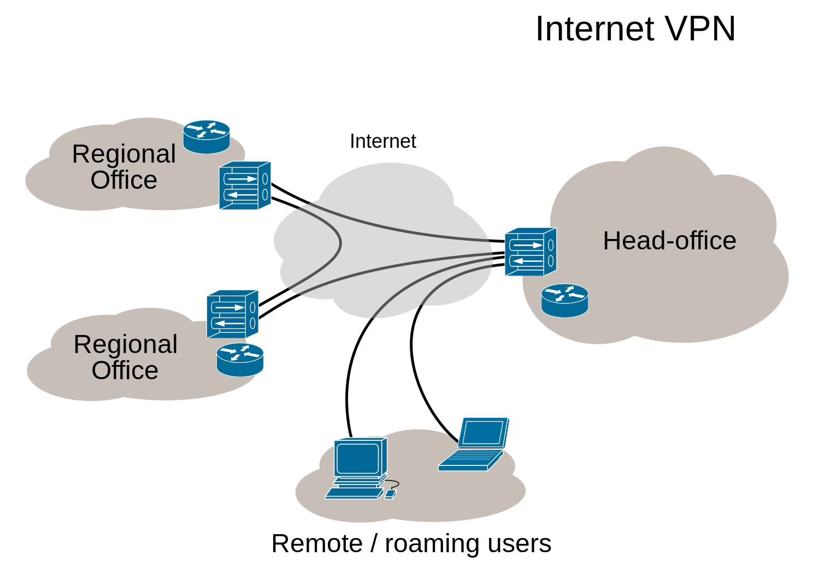

[Main Menu](../../../sessions/README.md) |[session9](../../session9/) | [Session 9 Notes](../docs/sessionNotes.md)

# Session 9 Notes  VPNs

A [virtual private network (VPN)](https://en.wikipedia.org/wiki/Virtual_private_network) is an overlay network that uses network virtualization to extend a private network across a public network, such as the Internet, via the use of encryption and tunneling protocols. In a VPN, a tunneling protocol is used to transfer network messages from one network host to another. 

VPNs can be site to site (also referred to as network to network) which allows a range of sites across a business to be addressed as one private network. 
VPNs can also be used to allow remote users to log into the network and access resources as if they were in the office.

(image source wikipedia)

SSH can be used to create a simple tunnel VPN but this fairly limited in its scope.

More frequently, physical or software appliances are used to provide a comprehensive edge routing facilities including VPN and firewall technology.
One such example is [OpnSense](https://docs.opnsense.org/) which includes most of the features available in expensive commercial firewalls. It brings the rich feature set of commercial offerings with the benefits of open and verifiable sources.

OpnSense was forked from [Pfsense](https://www.netgate.com/pfsense-plus-applications) when Netgate decided to restrict the original open source licence. 
Both products are essentially similar but Netgate also provides pre-built physical appliances.

Opnsense provides a packaged version of many of the technologies we have previously discussed including DNS, DHCP, VPNs using IPsec,Openvpn and Wireguard,  DNS using using Bind and dnsmasq.
It also provides a user authentication mechanism, a firewall and a captive portal

In this session we will do a simple introduction to VPN's but you are free to investigate further with the documentation if you wish.
OpenSense provides very good [vpn documentation](https://docs.opnsense.org/manual/vpnet.html) which is worth a read.

Opnsense also has a comprehensive Ansible collection which allows it to be configured remotely using ansible. 
See [https://github.com/O-X-L/ansible-opnsense](https://github.com/O-X-L/ansible-opnsense)

---
**Exercise  9.1**

[vagrant-opnsense](../vagrant-opnsense) is a project originally intended to create an Opnsense development environment using vagrant. 
We are using it to create a test environment to play with Opnsense networking.
OpnSense is build on BSD Unix which has a very different kernel to Linux. 
We need to use a BSD unix base image to install OpnSense in vagrant and the vagrant file downloads and installs opnsense on a base BSD image. 

Use `vagrant up` to build and start the image. You should see a ui appearing at https://192.168.56.56/

user : root password : opnsense

You are not expected to become an expert in Opnsense but look around the project to gain an awareness of its potential value in your use case.

Make sure you can explain 
* how to set up a VPN to a 'road warrior'
* how to set up a peer to peer vpn
* what benifits opnsense might provide
---

